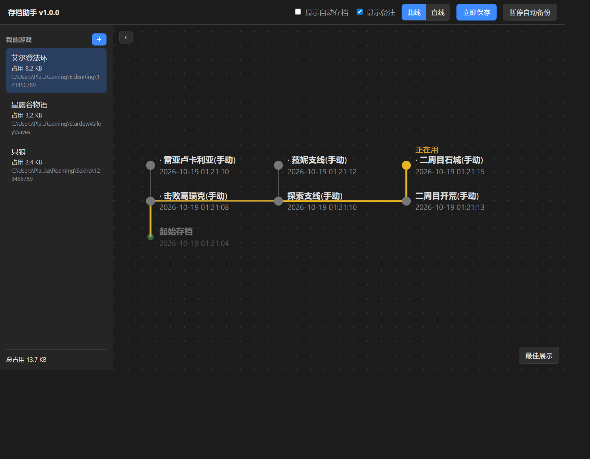
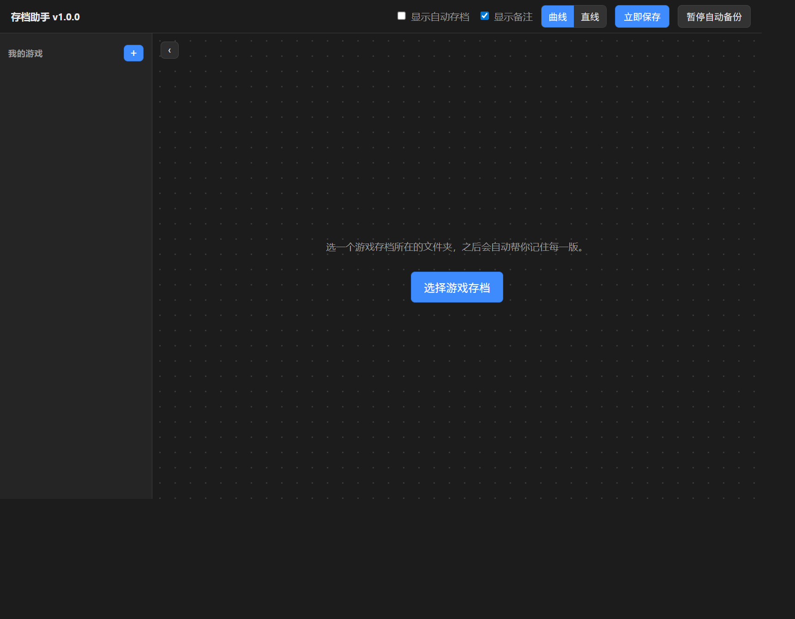

# 存档助手


给普通玩家用的游戏存档备份工具。选好存档文件夹之后，应用会在后台检查存档变化。主界面用树形图查看进度、回档和开新线。

## 下载

**[点击下载 Windows 版（最新）](https://github.com/XFSeven7/gamebackup/releases/latest/download/gamebackup-win64.zip)**

解压后双击 `start.bat`（推荐），或直接运行 `gamebackup.exe`。  
若提示被拦截：右键 zip / 文件夹 → 属性 → 勾选「解除锁定」。需要 Windows 10/11，并已安装 [WebView2](https://developer.microsoft.com/microsoft-edge/webview2/)（一般自带）。

历史版本见 [Releases](https://github.com/XFSeven7/gamebackup/releases)。

Windows 版启动后会在后台检查最新正式版本。发现应用更新时会弹窗提示，确认后显示下载进度。下载校验完成后，应用会自动安装并重启，存档和设置保留。

游戏支持包单独在后台检查和更新。「设置 → 当前支持的游戏」显示每款游戏正在使用的支持包版本和更新说明。应用只启用与当前接口兼容的支持包，校验或加载失败时继续使用可用版本。



## 能做什么

- **多游戏管理**：左边列出你在管的存档，各自占用空间一目了然
- **自动备份**：默认每两分钟检查一次。《鬼武者：剑之道》和《致命躯壳 2》可按大事件保存前后两份存档，其他游戏在存档变化时生成备份
- **树形进度**：分叉、标签、备注都能看见；当前进度高亮
- **安全回档**：默认另开一条线，当前进度不会被盖掉
- **托盘常驻**：关闭窗口后继续备份。可从托盘打开窗口、暂停备份或退出程序



## 怎么用

1. 打开应用，左侧会自动列出各个 Steam 库中已安装的游戏；安装或卸载后可点 **刷新**
2. 点 Steam 游戏下的 **跟踪存档**。扫描找到存档时可直接确认预填的路径，否则手动选择存档文件夹。确认后即进入存档树，之后可点 **查看存档** 直接打开
3. 之后正常玩游戏即可；重要节点可点 **立即保存**，或右键节点打标签 / 写备注
4. 想试另一条路线：从某个节点 **开新线**；想回去：双击或右键恢复（默认保留当前线）

备份数据默认在 `%LOCALAPPDATA%\gamebackup`。可在 **设置 → 更改位置** 选择空文件夹，迁移全部备份、分支、备注和摘要工具。迁移校验通过后会自动切换位置，下次启动继续使用新目录。

## 《鬼武者：剑之道》存档摘要

Steam 版《鬼武者：剑之道》可以在存档树中查看当前目标、游玩时长、红魂、背包和 Boss 再战进度，以及相对上一份备份的变化。右侧「Boss 进度」标签页按剧情出场顺序展示全部再战条目，状态随所选节点和存档槽更新。摘要从备份副本读取。

「成就」标签页展示所选备份的 52 项本地成就，支持按完成状态筛选。有计数记录的成就显示实际进度，包括京都奇谭、一树之荫、狛犬救助和幻魔杂记。

存档树会标出 Boss、探索、异闻和战斗成就的进展。关闭「显示自动存档」时，有进展的节点和大事件前后的备份仍会显示。首次识别在后台进行。

摘要需要单独安装 [Universal Save Editor](https://github.com/Lucasifium/universal-save-editor)。在项目源码目录运行：

```powershell
powershell -File scripts/install-summary-tools.ps1
```

脚本校验下载文件的 SHA-256 后，将解析器和物品名称表放到当前备份目录下的 `tools`。Windows 压缩包里的存档助手会使用同一目录。

## 《致命躯壳 2》存档摘要

添加 `%LOCALAPPDATA%\MortalShell2\Saved\SaveGames` 后，选择存档树中的节点可查看正式版槽位和试玩档的游玩时长、战斗进度、装备、货币和背包，以及与上一备份同一槽位的变化。摘要直接读取备份，无需安装工具。未对照游戏内名称的物品和重生点显示内部 ID。

## 运行（开发）

需要 Windows 10/11，并已安装 [WebView2](https://developer.microsoft.com/microsoft-edge/webview2/)。

```powershell
python -m pip install -r requirements.txt
python run.py
```

可选：用独立数据目录跑演示，不碰你自己的备份：

```powershell
$env:GAMEBACKUP_ROOT = "$PWD\docs\_demo_root"
python run.py
```

## 打包

```powershell
powershell -File scripts/build.ps1
```

产物：`dist/gamebackup-win64.zip`。

## 发布游戏支持包

内置包源码位于 `src/bundled_support`。改动某款游戏的解析、摘要布局或分支说明时，提高该游戏 `support.json` 的 `version`，并填写 `notes`。应用当前的支持包接口为 API 1。只有接口确实改变时才调整包里的 `api_min` 和 `api_max`。

```powershell
python scripts/build-support-pack.py 1.1.0
```

脚本将这次有新版本的游戏支持包打成 ZIP，并在 `dist/game-support/support-v1.1.0` 生成合并后的清单。将这些 ZIP 上传到本仓库同一个 `support-v1.1.0` 预发行版。发布标签和各游戏的支持包版本独立编号。附件上线后，用生成的清单更新 `main` 分支的 `game-support/manifest.json`，保留其他游戏和仍受旧应用支持的版本。签名使用当前用户的专用密钥，也可用 `--key` 指定。应用本体继续使用 `v1.x.y` 正式 Release，应用只内置签名公钥。

支持包用相对导入维护独立包结构。必需入口为 `summarize`、`read_event_state` 和 `major_events`。可选的分支索引入口接受包版本作为缓存命名空间。布局用 `tabs`、`sections`、`labels` 和 `branch_labels` 配置现有组件。

## 重新生成 README 截图

```powershell
python scripts/seed_readme_demo.py
python docs/readme-demo/serve.py
# 浏览器打开 http://127.0.0.1:8765/ 与 ?empty=1 截图
```

## 说明

- 设计文档：`docs/superpowers/specs/2026-08-24-gamebackup-design.md`
