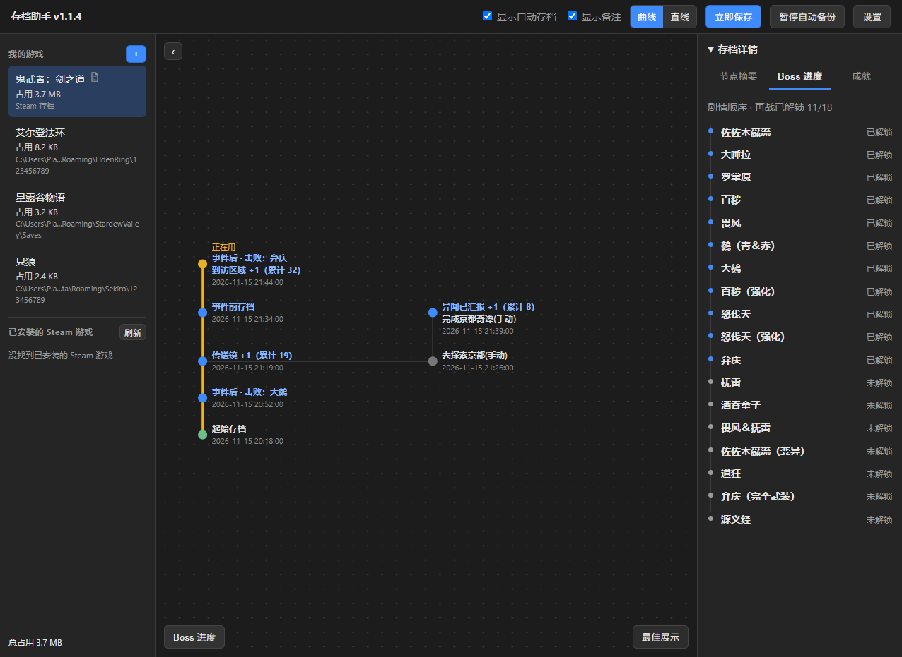
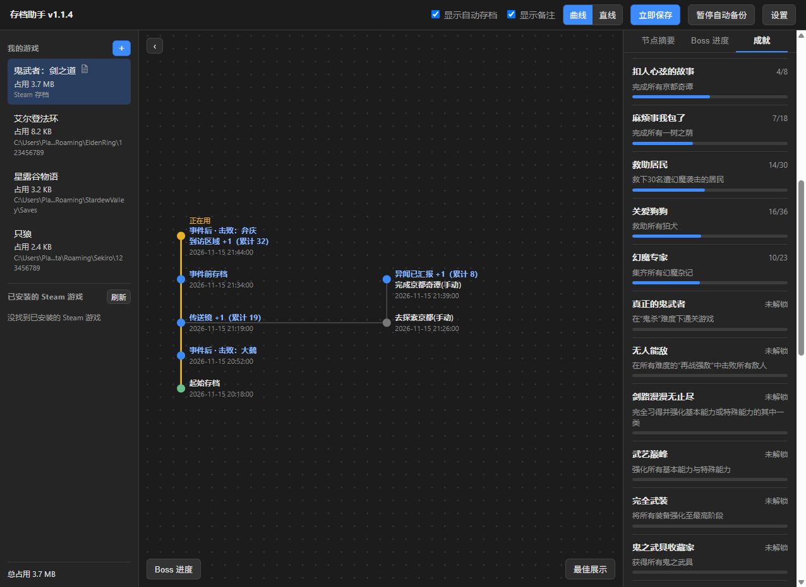

# 存档助手

给 PC 游戏的存档留个后手。想重打 Boss、试另一条路线，或者找回之前的进度，都可以从存档树里选一份备份。

**[下载 Windows 版](https://github.com/XFSeven7/gamebackup/releases/latest/download/gamebackup-win64.zip)**

解压后双击 `start.bat`。支持 Windows 10 和 11。

## 能做什么

- **后台备份**。默认每两分钟检查一次存档。想留住某个时刻，也可以随时点「立即保存」。
- **查看存档历史**。用树形图浏览各次备份，给重要存档加标签或写备注。隐藏普通自动存档后，重要事件仍然可见。
- **回档和开新线**。从历史存档继续玩，试试另一条路线，同时保留原有进度。
- **管理多个游戏**。可以从 Steam 游戏列表开始跟踪，也可以手动选择存档文件夹。

## 看看这版存档打到哪了

**《鬼武者：剑之道》**可查看当前目标、背包、Boss 再战和成就进度。Boss 按剧情出场顺序排列，成就可以按「已完成」和「未完成」筛选。

《鬼武者：剑之道》的详细进度需要额外准备读取工具。下载 [准备工具脚本](https://raw.githubusercontent.com/XFSeven7/gamebackup/main/scripts/install-summary-tools.ps1)，用 PowerShell 运行一次即可。

**《致命躯壳 2》**可查看游玩时长、战斗进度、装备和背包，也可以对照上一份备份，看这次多了什么。

这两款游戏在识别到击败 Boss 等重要事件时，可以保留事件前后各一份备份。上图为演示数据。

## 开始备份

1. 打开存档助手，在左侧找到游戏，点「跟踪存档」。也可以点「+」手动添加存档文件夹。
2. 确认存档位置后就可以继续玩。关闭窗口后，存档助手会留在系统托盘里继续备份。
3. 想回到之前的进度，双击存档节点。想试另一条路线，右键选择「开新线」。
